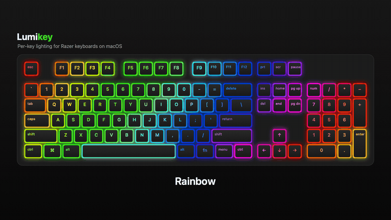
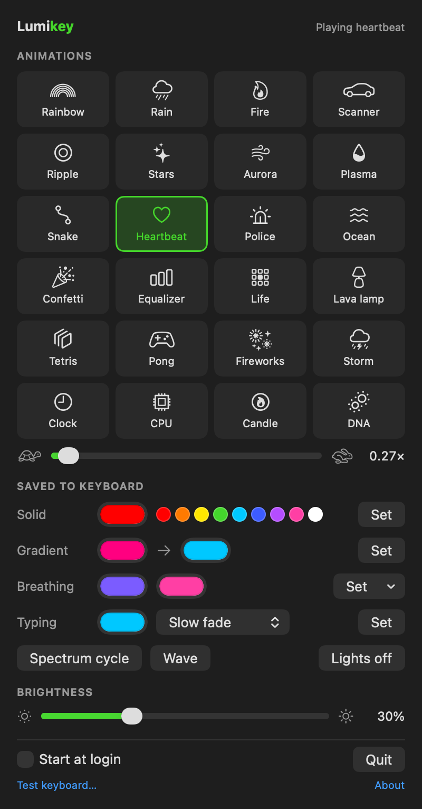

# Lumikey

**Per-key RGB lighting for Razer keyboards on macOS.** A small, free menu bar app, because Razer Synapse doesn't run on the Mac.

<p align="center">
  
</p>

<p align="center"><a href="docs/demo.mp4">Watch the full demo (12 animations, 38 seconds)</a></p>

## What it does

- **24 live animations**, drawn key by key: rainbow, rain, fire, aurora, plasma, ripples, snake, Tetris, Pong, fireworks, a lava lamp, a live clock, a CPU meter and more.
- **Effects stored in the keyboard**: solid colour, gradient, breathing, light up as you type, spectrum cycle and wave. They keep running even when the app is closed.
- **Speed control** from ¼× to 4×, remembered separately for each animation.
- **Brightness**, **start at login**, and it **puts your last effect back** when it starts or when you plug the keyboard in.
- **Lightweight**: no drivers, no kernel extensions, no permissions to grant. It lives in the menu bar.

<p align="center"></p>

## Keyboards

| Keyboard | Status |
| --- | --- |
| Razer Ornata V2 | ✅ Works |
| Razer Ornata V3, Ornata V3 Tenkeyless | 🧪 Experimental (lights in zones, not per key) |
| Razer Cynosa V2 | 🧪 Experimental |
| Razer BlackWidow Elite | 🧪 Experimental |
| Razer BlackWidow V3 Mini HyperSpeed (USB cable) | 🧪 Experimental |
| Razer BlackWidow V4, V4 Pro, V4 75%, V4 Tenkeyless HyperSpeed (cable), V4 Mini HyperSpeed (cable) | 🧪 Experimental |
| Razer Huntsman V2, V2 Tenkeyless, V2 Analog, Mini Analog | 🧪 Experimental |
| Razer Huntsman V3 Pro, V3 Pro Tenkeyless, V3 Pro Mini | 🧪 Experimental |
| Razer Joro | 🧪 Experimental |

**Experimental** keyboards use exactly the same commands as the Ornata V2, according to the [openrazer](https://github.com/openrazer/openrazer) driver, so they should work. Nobody has tried them with this app yet, though, so the app asks before using one.

**Have one of them?** Open the app, click **Test keyboard…**, answer the seven questions (about a minute) and send the report it makes. Each report that comes back moves a keyboard to ✅.

Wireless connections aren't supported yet: plug the keyboard in with its USB cable.

## Install

Needs macOS 14 (Sonoma) or later, on Apple Silicon or Intel.

1. Download the latest **Lumikey zip** from [Releases](https://github.com/gthanasis/lumikey/releases/latest), unzip it, and drag **Lumikey** into Applications.
2. Open it. macOS will say it can't verify the developer: the app is free and isn't signed with a paid Apple developer account. Click **Done**.
3. Go to **System Settings → Privacy & Security**, scroll down, and click **Open Anyway** next to Lumikey. You only need to do this once.

If macOS says the app "is damaged and can't be opened", run this in Terminal and open it again:

```sh
xattr -dr com.apple.quarantine "/Applications/Lumikey.app"
```

The app opens a window the first time. After that it lives in the menu bar (the keyboard icon). If your menu bar is full, the notch can hide the icon: open the app again from Spotlight or Finder to get the window.

### Or build it yourself

No warnings this way, because macOS trusts apps built on the same Mac. You need Apple's free command line tools:

```sh
xcode-select --install
git clone https://github.com/gthanasis/lumikey.git
cd lumikey
./build.sh
```

This builds the app, signs it for your Mac and installs it as `~/Applications/Lumikey.app`, quitting the running copy first.

## Troubleshooting

**"No keyboard found"**: check that the keyboard is connected with its USB cable, then run:

```sh
"/Applications/Lumikey.app/Contents/MacOS/Lumikey" --probe
```

It lists the Razer devices it can see and asks each keyboard for its firmware version. Quit the app first, because a playing animation keeps the keyboard busy. Please paste the output into an [issue](https://github.com/gthanasis/lumikey/issues) if something looks wrong.

**Razer Synapse or another lighting app is also running** (in a Windows VM, say): only one app can drive the lights at a time.

## How it works

Every command is a 90-byte HID feature report (`SET_REPORT`), sent to the keyboard's lighting interface. The byte layout comes from the [openrazer](https://github.com/openrazer/openrazer) Linux driver (`razerkbd_driver.c`, `razerchromacommon.c`).

macOS won't let an app open a keyboard's HID interfaces, so `RazerUSB.c` sends each report as a USB control request to the device through IOKit instead. That needs no permissions and no drivers, the same trick as [Razer macOS](https://github.com/1kc/razer-macos).

The keyboard drops packets sent back to back, so there's a 5 ms pause after each one. A per-key frame on the Ornata V2 is 7 packets, so animations run at about 28 fps.

Animations draw on the Ornata V2's 6 × 22 grid. On a keyboard with a different grid, each frame is resized to fit, so every animation works everywhere without knowing which keyboard it's on.

Speed doesn't change the frame rate. Instead each frame moves the effect forward by `speed` steps: above 1× it takes several steps per frame, and below 1× it blends between two consecutive steps, so slow motion stays smooth (`Lights.startAnimation`).

| File | What it does |
| --- | --- |
| `Sources/RazerUSB.c` | Finds Razer devices and sends reports over IOKit |
| `Sources/Keyboard.swift` | The supported keyboards and how each one is wired |
| `Sources/Protocol.swift` | Builds the reports: effects, brightness, per-key frames |
| `Sources/Effects.swift` | The animations, one class each |
| `Sources/Lights.swift` | Owns the keyboard: commands, the animation thread, saved state |
| `Sources/ControlPanel.swift` | The SwiftUI panel, used in the menu bar and the window |
| `Sources/KeyboardTest.swift` | The keyboard test and its report |
| `Sources/Demo.swift` | Draws the animations on a picture of a keyboard for the demo video |
| `Sources/App.swift` | App entry point, windows, command line options |

### Adding a keyboard

If openrazer supports it with the same commands as the Ornata V2 (transaction ID `0x1F`, `extended_matrix` effects), add a line to `Keyboard.all` with its product ID, USB interface (openrazer's `report_index`) and grid size (`MATRIX_DIMS` in openrazer's daemon). Then run the keyboard test.

### Making the demo and screenshot

The app draws them itself. You need [ffmpeg](https://ffmpeg.org) for the video:

```sh
./build.sh --no-install
scripts/make-demo.sh                                   # docs/demo.mp4 and docs/demo.gif
"build/Lumikey.app/Contents/MacOS/Lumikey" --snapshot docs/screenshot.png
```

### Releasing

Push a version tag. GitHub Actions builds a universal app and attaches it to a new release:

```sh
git tag v2.1 && git push origin v2.1
```

## Support the project

Lumikey is free. If it brought your keyboard back to life, you can [buy me a coffee through GitHub Sponsors](https://github.com/sponsors/gthanasis). Testing a keyboard and sending the report helps just as much.

## Credits and licence

The protocol details come from [openrazer](https://github.com/openrazer/openrazer), and the USB approach from [Razer macOS](https://github.com/1kc/razer-macos). Thank you to both projects.

MIT licence: see [LICENSE](LICENSE).

Not affiliated with or endorsed by Razer Inc. Razer, Ornata, BlackWidow, Huntsman, Cynosa and Joro are trademarks of Razer Inc., used here only to say which keyboards the app works with.
